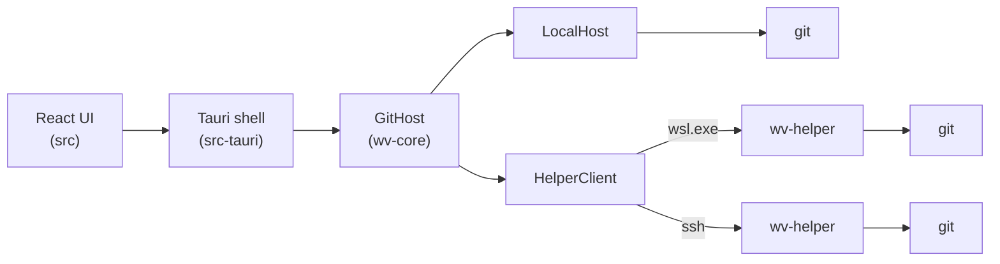

# Contributing to Grove

Thanks for helping with Grove! This guide covers building it, running its tests, the rules every change follows, and how the code fits together.

## Building from source

You need, on Windows:

- [Rust](https://rustup.rs) with the MSVC toolchain (and the Visual Studio C++ build tools it asks for).
- A current LTS release of [Node.js](https://nodejs.org), and pnpm (`corepack enable`).

```powershell
# 1. Build the helpers the app embeds (Git Bash is fine; WSL is not needed).
bash scripts/build-helpers.sh

# 2. Build the app
pnpm install
pnpm tauri dev      # run in development mode
pnpm tauri build    # installer in target\release\bundle\nsis\
```

> [!NOTE]
> Repeat step 1 whenever `crates/wv-helper` or `crates/wv-core` changes: the app build stops if a helper is older than that code. If you skip step 1 entirely, the app still builds, with a warning, but WSL and SSH repositories won't open.

## Tests

```sh
cargo test           # core parsers, path routing, helper protocol and install
cargo test -p grove  # the Tauri side
pnpm test            # UI logic (Vitest)
pnpm ui-check        # design system and shell, in headless Edge
pnpm ui-check --fast # the same at high priority, when you wait on it
```

`cargo test` covers the shared crates on any OS, against that OS's git. `pnpm ui-check` builds the harness pages once, then runs its checks across four headless Edge tabs at below-normal priority, so the machine stays usable while it runs. `--fast` raises it to high priority instead; `--tabs=1` runs every check in one tab, in turn. `bash scripts/test-ssh-host.sh` runs the helper against a stock OpenSSH server in a throwaway Docker container.

Run `cargo test`, `pnpm test` and, for UI changes, `pnpm ui-check` before sending a pull request, and add tests for new parsing or path logic.

## Guidelines

- **Allowlist.** Every git command the app runs goes through the allowlist in [`crates/wv-core/src/allowlist.rs`](crates/wv-core/src/allowlist.rs). A new command, especially one that writes to a repository, needs an entry there with tests, and must be triggered by an explicit user action. Nothing may be forced or run in the background.
- **Fixtures.** Test fixtures are generated by [`scripts/make-fixtures.sh`](scripts/make-fixtures.sh) from throwaway repositories. Don't commit output captured from real repositories, or paths, names or emails from your own machine. Use made-up examples such as `\\wsl.localhost\Ubuntu\home\user\src\example`.
- **Larger changes.** Open an issue first, so we can agree on the approach.

## Trying the app

To try the app against a repository, pass it at run time rather than in a committed file:

- `scripts/test-run.ps1 -Repo <path>` starts a separate instance with its own settings folder.
- `scripts/make-worktrees-demo.sh <folder>` builds a throwaway repository with three overlapping worktrees, to try the Worktrees overview on.
- `scripts/take-screenshots.ps1` retakes the README screenshots in `docs/images`, in both themes, from a demo repository built by `scripts/make-screenshot-demo.sh`. Run it after a visible UI change.
- `scripts/shot.ps1` captures the Grove window to a PNG, and `scripts/measure-memory.ps1 -Proc <name>` sums an instance's memory use.

### Test hooks

Environment variables let a second instance be driven without touching your own settings. Set `WEBVIEW2_USER_DATA_FOLDER` as well to give the instance its own WebView2 processes.

| Variable | Effect |
| --- | --- |
| `WV_CONFIG_DIR` | Settings folder |
| `WV_TITLE` | Window title |
| `WV_OPEN_DIFFS=n` | Opens the first n *Branch vs base* diffs |
| `WV_OPEN_FILE=path` | Opens a file |
| `WV_SHOW_HISTORY=1\|<sha>` | Shows History, optionally selecting a commit |
| `WV_OPEN_COMMIT_FILE=path` | Opens a file of the commit `WV_SHOW_HISTORY` selected |
| `WV_OPEN_REV_FILE=<rev>:<path>` | Opens a file at a revision |
| `WV_RUN_ACTION=fetch\|push\|publish` | Runs the header action |
| `WV_LEFT_TAB=changes\|history\|explorer\|search` | Picks the left pane tab |
| `WV_OPEN_SETTINGS=1\|settings.json\|<search>` | Opens Settings |
| `WV_SETTINGS_PATCH=<json>` | Patches settings at start |
| `WV_CONTEXT_MENU=<place>[:key][>Label]` | Opens a context menu, e.g. `"tab>Close others"` |
| `WV_FILE_HISTORY=path` | Opens a file's history |
| `WV_BLAME=1\|click:<line>` | Shows blame, optionally clicking a line |
| `WV_HISTORY_SEARCH=text` | Searches history |
| `WV_IMAGE_ZOOM=in\|out\|fit\|<scale>` | Zooms an image |
| `WV_PREVIEW_LINK=n` | Follows an HTML preview's n-th link |
| `WV_REVEAL=path` | Reveal in Explorer |
| `WV_LIST_KEYS=ArrowDown,ArrowLeft,…` | Keys pressed in the left pane's list |
| `WV_WORKTREES=1\|chip:<n>\|feed:<n>` | Opens the overview, then clicks the n-th worktree of a shared file or the n-th Activity link |

## Releasing

Releases are built by [`.github/workflows/release.yml`](.github/workflows/release.yml) on a Windows runner: it builds the helpers, runs the tests, builds the installer and attaches it to a **draft** release.

1. Set the new version in `src-tauri/tauri.conf.json`, `package.json` and `[workspace.package]` in `Cargo.toml`, then run `cargo check` so `Cargo.lock` follows. `node scripts/check-version.mjs` confirms the three agree.
2. Commit, then tag and push:

   ```sh
   git tag v0.2.0
   git push origin main v0.2.0
   ```

3. When the workflow finishes, open the draft on the Releases page, write the notes, and publish it.

The workflow stops before building if the tag does not match the version in those files. To rebuild an existing tag, run it from the Actions tab with that tag.

> [!NOTE]
> Release builds embed the Linux helpers (x86-64 and Arm64) and the Windows one. macOS helpers need a Mac runner and are not built yet, so SSH hosts running macOS can't be opened from a release build.

## How it works



| Part | Role |
| --- | --- |
| [`crates/wv-core`](crates/wv-core) | Git output parsers, the command allowlist, local/WSL/SSH path routing, the `GitHost` trait with a local implementation, the helper protocol client, helper installation (`remote`), the file watcher, and every repository operation the UI uses. |
| [`crates/wv-helper`](crates/wv-helper) | A small binary started once per WSL distro or SSH host, on the machine holding the repository. It runs git, reads files and watches worktrees there, and talks JSON lines over stdin/stdout. See [docs/ssh.md](docs/ssh.md). |
| [`src-tauri`](src-tauri) | The Tauri 2 shell and commands, and the `wvfile:` URL scheme (`http://wvfile.localhost/`) that image views and HTML previews read repository files from: images, stylesheets, fonts and scripts only, read-only, under a random token per repository, worktree and revision, never cached. HTML previews are served from it too, prepared by the UI, under a content security policy that allows no network and scripts only when the repository allows them. |
| [`src`](src) | The React UI. Monaco is bundled locally, with only the editor worker. |
