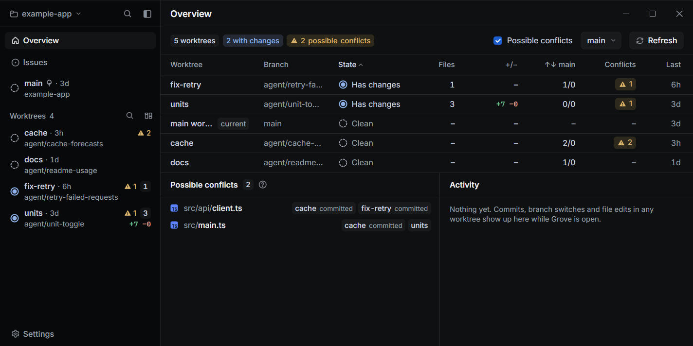
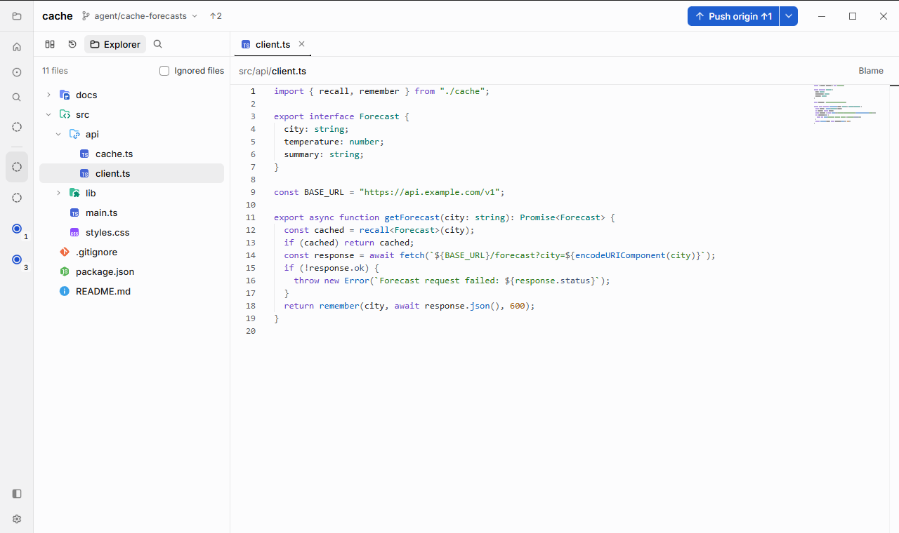
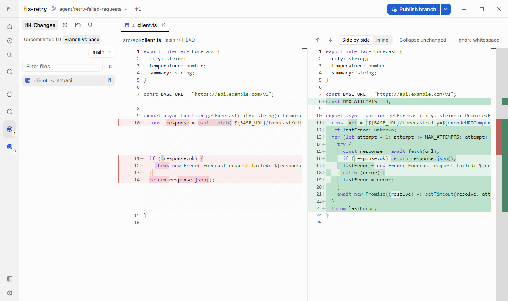

# Grove

**A read-only code explorer and Git client for worktrees.** 
Browse, search and review every worktree side by side: ideal when coding agents write the code.

[Features](#features) • [Install](#install) • [Quick start](#quick-start) • [Docs](#documentation)

Grove is a small, fast Windows desktop app for reading code across git repositories and their worktrees. Explore and search the files of any worktree or branch, and review its changes, history and blame, all in VS Code's editor. Everything opens read-only, so you can look inside a worktree an agent is busy in without getting in its way.

- **A read-only editor with an Explorer.** Every file of every worktree or branch, with Quick Open, `git grep` search, syntax highlighting, and Markdown, images and HTML rendered. Only the `.env` and local config files you choose can be edited.
- **Worktrees first.** Every worktree side by side, watched live, with files that two of them both change flagged before they become merge conflicts.
- **Safe by default.** Grove never changes your index, commits or stashes. Every git command is on an allowlist, and the few that write (`fetch`, `push`, `clone`) only run when you click a button.
- **Local, WSL and SSH.** Repositories can live on Windows, in any WSL distro, or on another machine. For WSL and SSH, a small helper runs git next to the repository, so nothing goes over a slow file share.

## Features

- **Explorer** for any worktree or branch, without checking anything out, that follows the file you are reading
- **Read-only editor** (Monaco) with syntax highlighting, find, go to line, and tabs for files, diffs and issues
- **Search** with `git grep`, Quick Open and a command palette that finds worktrees, changed files and commands
- **Rendered Markdown, images and HTML**, with image diffs and a sandboxed HTML preview
- **Worktrees overview** with branches, changes, ahead/behind counts, possible conflicts and a live activity feed
- **Changes and History** with side-by-side or inline diffs, blame and rename-aware file history
- **Editable `.env` and local config files**, while everything else stays read-only
- **GitHub issues**, read-only, beside your code

<table>
  <tr>
    <td width="50%">
      <picture>
        <source media="(prefers-color-scheme: dark)" srcset="docs/images/explorer-dark.png" />
        
      </picture>
    </td>
    <td width="50%">
      <picture>
        <source media="(prefers-color-scheme: dark)" srcset="docs/images/diff-dark.png" />
        
      </picture>
    </td>
  </tr>
  <tr>
    <td align="center"><em>Explorer and read-only editor</em></td>
    <td align="center"><em>Branch vs base diff</em></td>
  </tr>
</table>

See [docs/features.md](docs/features.md) for the full tour and keyboard shortcuts.

## Install

1. Download the latest `Grove_<version>_x64-setup.exe` from the [Releases](../../releases) page.
2. Run it. It installs for the current user and needs no admin rights.

You also need [Git for Windows](https://git-scm.com/download/win) on your `PATH`, plus `git` in each WSL distro or SSH host you open repositories from.

> [!WARNING]
> The installer is not code-signed yet, so SmartScreen may show *"Windows protected your PC"*. Click **More info**, then **Run anyway**, or [build it yourself](CONTRIBUTING.md#building-from-source).

> [!IMPORTANT]
> Grove is Windows only for now (Windows 10 or 11 with WebView2). Linux and macOS builds are welcome contributions.

## Quick start

1. Open the **Repository** menu at the top left and choose **Add repository…**
2. Pick a folder (`C:\src\example` or `\\wsl.localhost\Ubuntu\home\user\src\example`), switch to **SSH** (`ssh://user@host/home/user/src/example`), or **Clone** from a URL.
3. Press **Ctrl+Shift+O** to see all its worktrees, or **Ctrl+K** to jump anywhere.

> [!TIP]
> For SSH repositories, Grove uses your ssh config, keys and agent, and cannot ask for a passphrase. Load your keys into `ssh-agent` and connect once from a terminal first. See [docs/ssh.md](docs/ssh.md).

## Documentation

| Guide | What's in it |
| --- | --- |
| [Features](docs/features.md) | Everything Grove does, settings and keyboard shortcuts |
| [What Grove writes and sends](docs/privacy.md) | The git commands it may run, its network use and GitHub tokens |
| [Remote hosts](docs/ssh.md) | How WSL and SSH repositories work, and supported systems |
| [Contributing](CONTRIBUTING.md) | Building from source, tests, test hooks and architecture |

---

Free and open source under the <a href="LICENSE">MIT licence</a>. Third-party components are listed in <a href="THIRD_PARTY_NOTICES.md">THIRD_PARTY_NOTICES.md</a>.

